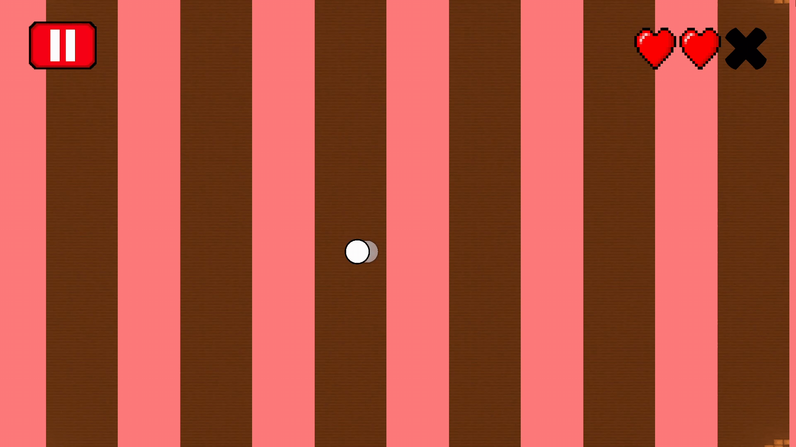

# Litany_Unity

**Litany** - 2D игра, созданная на Unity(2022.3.58f1) 

Основной геймплей игры схож со стилем таких игр как: (Just Shapes & Beats и undertale) именно ними я и вдохновлялся при создании

### Browser
[[ Play on itch.io ]](<https://void-t.itch.io/litany>)

### Windows Version
[[ Download Windows build ]](<https://github.com/VoidTT1/Litany_Unity/releases/tag/Game>)

## Gif:

---------------------------------------

---------------------------------------

## Controls

 - Передвижение - WASD
 - Рывок - E
 - Щит - R

## Геймплей
В игре всего 4 тира, по 5 уровне в каждом(в общем 20 уровней) за прохождения которых в зависимости от количества ваших жизней вам начисляются кристалы, которые можно потратить на различные улучшения в магазине, например:
 - 75 кристаллов: x2 жизней, теперь у вас 6 жизней(потеря дополнительных жизней не влияет на итоговую награду)
 - 45 кристаллов: регенерация, после потери жизни начинается таймер по окончанию которого вам вернётся ваша жизнь
 - 150 кристаллов: Щит, при нажатии на R вы получаете неуязвимость на 10 секунд, КД: 30 секунд
 - 40 кристаллов: Телепорт, (Способность рывка) вы телепортируетесь вместо рывка
 - 50 кристаллов: Большой рывок, совместимо с телепортом

Улучшения для рывка можно экипировать все одновременно, способности только по одному

5-е уровни каждого тира - уровни с боссом(по сути усложнённые уровни с большей наградой)

В игре присутствует множество различных атак и механик, такие как: 
- двигайся/не двигайся - атака взята из игры undertale, сверху экрана появляется последовательность оранжевых и синих квадратов которую нужно запомнить и в зависимости от его цвета двигатся или же нет(Оранжевый - двигайся, Синий - не двигайся)
- Ещё одна атаки на память, сверху экрана появляются стрелки, которые нужно запомнить и после паузы воспроизвести комбинацию движением
- Увеличение/уменьшение экрана для других разновидностей атак
- многочисленные лучи и лазеры

Я бы посоветовал протестировать 3 и 4 тир, а 1й пропустить (2й по желанию) потому что в игре сложность идёт по нарастанию(с каждым тиром всё сложнее) и из за этого 1й стал попросту скучным, а для такой непопулярной игры  это очень критично, именно из за этого я полностью убрал прогрессию по уровням, и теперь можно начать сразу с последнего

## Other
### Если вы хотите протестировать способности, но не хотите долго проходить уровни то 
в настройках с низу справа можно найти кнопку которая даёт + 100 кристаллов

# Technical section

Это мой самый первый (полноценный) проект который я создал на движке Unity, именно в нём я познакомился с тем что такое Unity, её архитектурой и особенностями.
По ходу его создания мне приходилось много сидеть в интернете и на форумах ища подходящие мне скрипты и решения тех или иных задач(Нейросети тогда только начинали появляться, и не сильно помогали со сложными решениями).
почти все атаки в игре появляются не из префаба как это в моих остальных проектах, а изначально находятся на сцене, и скрипт на пустышке просто показывает их по очерёдности(👍), не все атаки так работают [ErrorAttack.cs](https://github.com/VoidTT1/Litany_Unity/blob/main/Assets/Scripts/ErrorAttack.cs), но большинство. 
В этом проекте я научился использовать сохранения через PlayerPrefs, а так же узнал что такое коррутины [Player.cs](https://github.com/VoidTT1/Litany_Unity/blob/main/Assets/Scripts/Player.cs) и как с ними правильно работать(ну а ещё архитектуру Unity в принципе [HealthUIManager.cs](https://github.com/VoidTT1/Litany_Unity/blob/main/Assets/Scripts/HealthUIManager.cs))

Главной моей ошибкой в создании этого проекта был объём, который я выбрал. Из-за того, что я тогда был неопытным в unity, многие задачи я реализовывал неправильно.
Проект архитектурно ужасен: на сцене хаотично раскиданы пустышки с выключенными объектами внутри, и если удалить один из объектов(к примеру на уровне) то уровень может перестать работать. Недавно, когда я снова просматривал этот проект, я не стал сильно что то менять и изменять, потому что, чтобы привести его в нормальный вид, нужно полностью его переработать. Делать я это уже не стал, лишь немного подправил некоторые визуальные части и оставил как есть, работает = не трогай)

# Resources used
Почти все атаки - это объекты с самого Unity, 

Вся музыка в игре взята с сайта: https://freesound.org/

Все остальные ресурсы так же были бесплатными и без авторского права(ссылок уже вспомню)

# Developer

**Solo Developer - VoidTT1**

